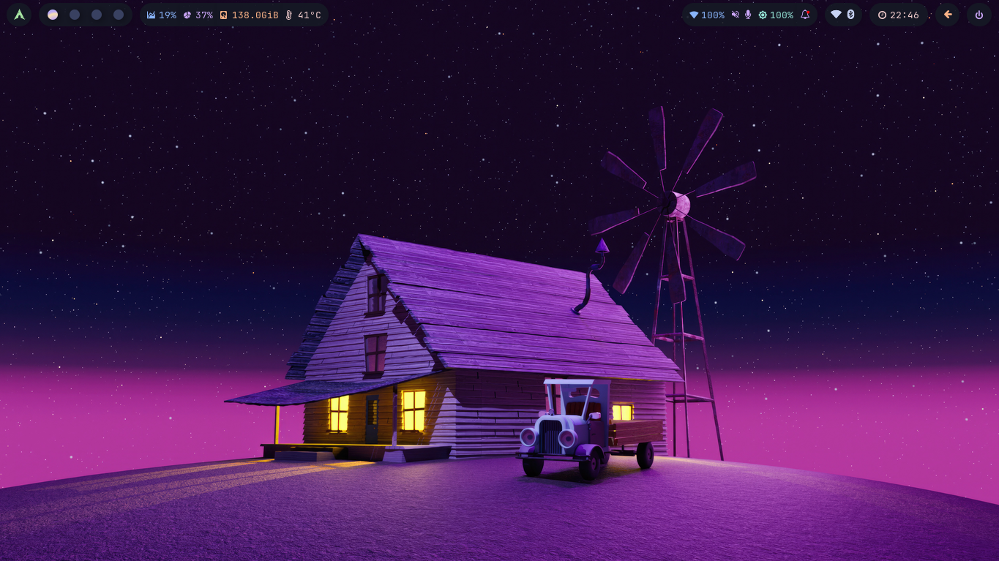
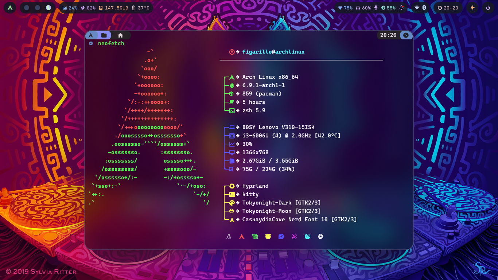
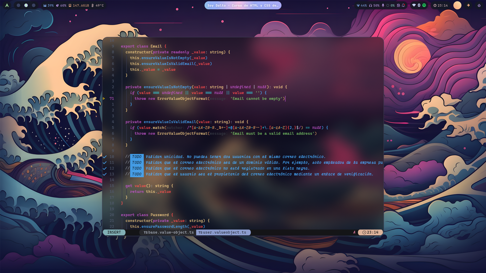
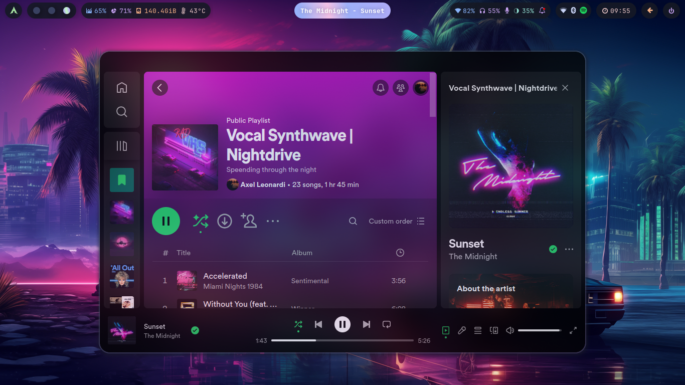

<h1 align="center">Dotfiles — Hyprland on Arch</h1>

<p align="center">
  Personal Hyprland configuration for Arch Linux
</p>



<br>

<details><summary>Screenshots</summary>

**Neofetch**


**Neovim**


**Spotify**


</details>

---

## Stack

| Category | Tool |
|----------|------|
| Compositor | [Hyprland](https://hyprland.org/) 0.54 |
| Bar | [Waybar](https://github.com/Alexays/Waybar) |
| Launcher | [Fuzzel](https://codeberg.org/dnkl/fuzzel) |
| Notifications | [SwayNC](https://github.com/ErikReider/SwayNotificationCenter) |
| Terminal | [Kitty](https://sw.kovidgoyal.net/kitty/) |
| Shell | Zsh + [Oh My Zsh](https://ohmyz.sh/) + [Starship](https://starship.rs/) |
| Shell history | [Atuin](https://atuin.sh/) |
| File manager | [Nemo](https://github.com/linuxmint/nemo) |
| Editor | [VSCodium](https://vscodium.com/) |
| Browser | [Zen Browser](https://zen-browser.app/) |
| Wallpaper | [awww](https://github.com/leonidstadnichenko/awww) |
| Music | MPD + Spotify |
| Bluetooth | Blueman |
| Logout | [Wlogout](https://github.com/ArtsyMacaw/wlogout) |
| Boot splash | [Plymouth](https://www.freedesktop.org/wiki/Software/Plymouth/) — proxzima theme |
| Bootloader | GRUB — boo theme |
| Login manager | GDM |

---

## Keybindings

### Applications

| Keybind | Action |
|---------|--------|
| `SUPER + RETURN` | Terminal (Kitty) |
| `SUPER + W` | Browser (Zen) |
| `SUPER + SHIFT + W` | Browser alt (Brave) |
| `SUPER + E` | Editor (VSCodium) |
| `SUPER + F` | File manager (Nemo) |
| `SUPER + M` | Spotify |
| `SUPER + D` | Discord |
| `SUPER + G` | Gmail (Geary) |
| `SUPER + O` | OnlyOffice |
| `SUPER + SHIFT + O` | Obsidian |
| `SUPER + B` | Bluetooth (Blueman) |
| `SUPER + T` | Floating terminal |
| `SUPER + ALT + RETURN` | Fullscreen terminal |

### Window management

| Keybind | Action |
|---------|--------|
| `SUPER + Q` | Close window |
| `SUPER + H/J/K/L` | Move focus |
| `SUPER + ←/↑/↓/→` | Move focus (arrows) |
| `SUPER + SHIFT + H/J/K/L` | Move window |
| `SUPER + CTRL + H/J/K/L` | Resize window |
| `SUPER + S` | Toggle floating |
| `SUPER + P` | Toggle pseudo-tile |
| `SUPER + A` | Toggle split |
| `SUPER + ALT + M` | Fullscreen |
| `SUPER + ALT + C` | Center window |
| `SUPER + SHIFT + G` | Toggle group |
| `SUPER + CTRL + TAB` | Cycle group |

### Workspaces

| Keybind | Action |
|---------|--------|
| `SUPER + TAB` | Next workspace |
| `SUPER + SHIFT + TAB` | Previous workspace |
| `SUPER + 1-9` | Go to workspace |
| `SUPER + SHIFT + 1-9` | Move window to workspace |
| `SUPER + Mouse wheel` | Cycle workspaces |
| `SUPER + Mouse drag` | Move/resize window |

### Visual toggles

| Keybind | Action |
|---------|--------|
| `SUPER + Z` | Toggle animations |
| `SUPER + ALT + Z` | Toggle clean mode (removes all transparency and blur) |

### Wallpaper

| Keybind | Action |
|---------|--------|
| `SUPER + ]` | Next wallpaper |
| `SUPER + [` | Previous wallpaper |

Wallpapers are read from `~/Pictures/Wallpapers/`. The last used wallpaper is remembered across reboots.

### Utilities

| Keybind | Action |
|---------|--------|
| `SUPER + SPACE` | App launcher |
| `SUPER + SUPER_L` | App launcher (drun) |
| `SUPER + V` | Clipboard history |
| `SUPER + N` | Notification center |
| `SUPER + SHIFT + S` | Screenshot (region) |
| `Print` | Screenshot (full) |
| `SUPER + SHIFT + C` | Color picker |
| `SUPER + .` | Emoji picker |
| `SUPER + ESC` | Logout screen |
| `SUPER + ALT + L` | Lock screen |
| `SUPER + SHIFT + R` | Reload Waybar |
| `ALT + TAB` | Cycle windows |

### Media & brightness

| Keybind | Action |
|---------|--------|
| `XF86AudioRaiseVolume` | Volume up |
| `XF86AudioLowerVolume` | Volume down |
| `XF86AudioMute` | Mute |
| `XF86MonBrightnessUp/Down` | Brightness |
| `SUPER + SHIFT + P` | Play/pause |
| `SUPER + SHIFT + ]` | Next track |
| `SUPER + SHIFT + [` | Previous track |

---

## Installation

### Restore this machine (quick path)

Rebuilds the current setup on a fresh Arch install. Assumes a **btrfs** root, **GRUB** and **zram** (all defaults in `archinstall`).

```sh
# 1. Base tools + yay
sudo pacman -S --needed git base-devel stow
git clone git@github.com:Figaarillo/dotfiles.git ~/dotfiles
git clone https://aur.archlinux.org/yay-bin.git /tmp/yay-bin && (cd /tmp/yay-bin && makepkg -si)

# 2. Packages (pkglist-intel.txt only on Intel CPU/GPU)
sudo pacman -S --needed - < ~/dotfiles/system/pkglist-repo.txt
sudo pacman -S --needed - < ~/dotfiles/system/pkglist-intel.txt
yay -S --needed - < ~/dotfiles/system/pkglist-aur.txt

# 3. User configs (symlinks into $HOME)
cd ~/dotfiles && stow -t ~ autostart bat btop cava config dotscripts firefox fuzzel geany gtk hypr kitty \
  mouse-icons nemo neofetch nvim starship swaync thunar tmux vscodium waybar wlogout wofi zsh
# If stow reports conflicts, delete the default files it names (e.g. ~/.config/hypr/hyprland.lua) and retry.

# 4. System configs (/etc): pacman, makepkg, zram, journald, mirrors, initramfs, GRUB
sudo ~/dotfiles/system/install.sh
```

Reboot, then check:

- [ ] `systemd-analyze` → userspace boot well under a minute
- [ ] `systemctl --failed` and `systemctl --user --failed` → empty
- [ ] `sysctl vm.swappiness` → `180`
- [ ] `notify-send test` → notification shows up (SwayNC)

Not covered by the lists, install by hand:

- **MEGAsync**: comes from MEGA's own repo. Install it from mega.nz and it adds the repo to `pacman.conf`. `install.sh` keeps that block on re-runs.
- **ttf-maple**: removed from AUR, so grab it from its upstream releases.
- Shell plugins, GTK theme and cursor: see the sections below.

When an update breaks, read [docs/arch-maintenance.md](docs/arch-maintenance.md) first.

To refresh the package lists after installing or removing things:

```sh
pacman -Qqen > system/pkglist-repo.txt   # then move hardware/MEGA packages out by hand
pacman -Qqem > system/pkglist-aur.txt
```

The sections below explain each piece individually.

### Base dependencies

```sh
sudo pacman -Syy \
  base-devel mtpfs \
  gvfs gvfs-mtp gvfs-gphoto2 \
  gnome-keyring \
  jq unzip unrar \
  bluez bluez-utils \
  zsh neovim git
```

### Hyprland and core tools

```sh
yay -S \
  hyprland xdg-desktop-portal-hyprland wayland-protocols \
  waybar wlogout wofi \
  awww swaync grim slurp \
  qt5-base qt5-wayland qt6-base qt6-wayland qt5ct qt6ct polkit-gnome \
  pipewire pipewire-alsa pipewire-pulse pipewire-jack wireplumber \
  brightnessctl playerctl pavucontrol-gtk3 mpd mpd-mpris \
  blueman network-manager-applet libinput-gestures \
  cava kitty starship tty-clock-git btop geany bat cliphist \
  reflector \
  --needed
```

### Shell

```sh
# Oh My Zsh
sh -c "$(curl -fsSL https://raw.githubusercontent.com/ohmyzsh/ohmyzsh/master/tools/install.sh)"

# Plugins
git clone https://github.com/zsh-users/zsh-autosuggestions ${ZSH_CUSTOM:-~/.oh-my-zsh/custom}/plugins/zsh-autosuggestions
git clone https://github.com/zsh-users/zsh-syntax-highlighting.git ${ZSH_CUSTOM:-~/.oh-my-zsh/custom}/plugins/zsh-syntax-highlighting
git clone https://github.com/zsh-users/zsh-completions ${ZSH_CUSTOM:=~/.oh-my-zsh/custom}/plugins/zsh-completions

# Atuin (shell history)
curl --proto '=https' --tlsv1.2 -LsSf https://setup.atuin.sh | sh
```

### Fonts

```sh
sudo pacman -S \
  noto-fonts noto-fonts-cjk noto-fonts-emoji \
  ttf-cascadia-code ttf-cascadia-code-nerd \
  ttf-jetbrains-mono ttf-jetbrains-mono-nerd \
  ttf-font-awesome ttf-nerd-fonts-symbols-mono

fc-cache -fv
```

### GTK Theme — Tokyonight

```sh
cd ~/Downloads
git clone https://github.com/Fausto-Korpsvart/Tokyonight-GTK-Theme.git
cd Tokyonight-GTK-Theme/

# GTK 3
cp -r themes/Tokyonight-Dark-BL-LB ~/.themes
# GTK 4
cp -r themes/Tokyonight-Dark-BL-LB ~/.config/gtk-4.0
# Icons
sudo cp -r icons/Tokyonight-Moon /usr/share/icons/
```

### Cursor — Layan

```sh
# Available in AUR
yay -S layan-cursor-theme-git
```

---

## Boot & login

Thanks to [PROxZIMA](https://github.com/PROxZIMA) for the GRUB and Plymouth themes.

```sh
yay -S boo-grub-git proxzima-plymouth-git
```

### GRUB

Edit `/etc/default/grub`:
```
GRUB_THEME="/usr/share/grub/themes/boo/theme.txt"
GRUB_CMDLINE_LINUX_DEFAULT="loglevel=3 quiet splash"
```

```sh
sudo grub-mkconfig -o /boot/grub/grub.cfg
```

### Plymouth

Add `plymouth` to the HOOKS in `/etc/mkinitcpio.conf`, after `udev`:
```
HOOKS=(base udev plymouth autodetect ...)
```

Set the theme and rebuild initramfs:
```sh
sudo plymouth-set-default-theme -R proxzima
sudo mkinitcpio -P
```

### GDM cursor fix

To prevent a ghost cursor from the login screen appearing over Hyprland:
```sh
sudo mkdir -p /etc/dconf/db/gdm.d/
sudo tee /etc/dconf/db/gdm.d/01-cursor << 'EOF'
[org/gnome/desktop/interface]
cursor-theme='Layan-cursors'
cursor-size=24
EOF
sudo dconf update
```

---

## Structure

```
dotfiles/
├── hypr/           → Hyprland config
│   └── .config/hypr/
│       ├── hyprland.lua    → entry point (Hyprland 0.57+ Lua config)
│       └── configs/
│           ├── autostart       → startup script
│           ├── vars.lua        → apps and paths shared by the other files
│           ├── decorations.lua
│           ├── animations.lua  → spring curves (iOS-style)
│           ├── keybindings.lua
│           ├── rules.lua
│           ├── env.lua
│           ├── monitor.lua
│           └── cleanmode.lua   → clean mode, toggled by a flag file (SUPER+ALT+Z)
├── dotscripts/     → shell scripts (~/.scripts/ and ~/.config/scripts/)
├── waybar/         → Waybar config and styles
├── fuzzel/         → Fuzzel launcher config
├── wofi/           → Wofi launcher styles (previous launcher)
├── kitty/          → Kitty terminal config
├── zsh/            → Zsh config and aliases
├── swaync/         → Notification center config
├── wlogout/        → Logout screen
├── nvim/           → Neovim config
├── starship/       → Starship prompt
├── gtk/            → GTK settings
├── system/         → NOT stowed: /etc configs + install.sh + package lists
│   ├── install.sh
│   ├── pkglist-repo.txt / pkglist-intel.txt / pkglist-aur.txt
│   └── etc/        → mirrors /etc (pacman, makepkg, sysctl, zram, journald, reflector, mkinitcpio, grub)
└── docs/
    └── arch-maintenance.md → known breakages and fixes
```
